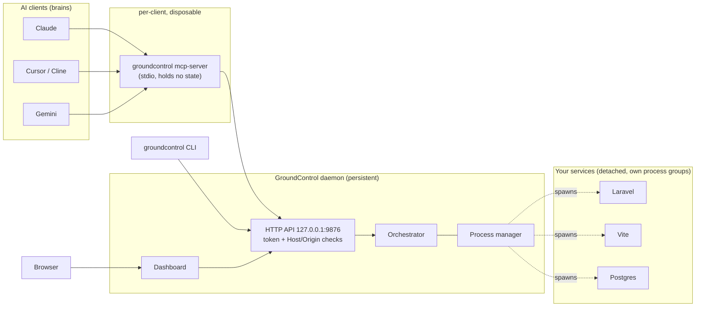

# GroundControl

**GroundControl keeps your dev servers running when your AI session ends.**

It is a small background daemon that owns your local processes (Laravel, Vite, Postgres in Docker, queue workers, ...), plus a CLI, a web dashboard and an [MCP](https://modelcontextprotocol.io) bridge. Any AI client (Claude, Cursor, Cline, Gemini, ...) can start, stop and read logs from the same persistent state, and so can you, without spending a single token.

## The problem

AI coding tools couple *intelligence* with *execution*. When the tool hits a rate limit, crashes, or you close the window, the terminal it opened dies and so do your servers. The next AI session has no idea what was running.

## The solution: brain and hands

| | Brain (AI clients) | Hands (GroundControl) |
|---|---|---|
| Examples | Claude, Cursor, Cline, Continue, Gemini | the GroundControl daemon |
| Job | decide *what* to run, write code | run it, keep it alive, remember its logs |
| Lifetime | one session | until you stop it |



Why this works: the MCP server is only a **thin bridge**. It dies with the AI client, but the daemon and the services do not. Services are started in their own process groups with output written straight to log files, so even the daemon can restart and **re-adopt** them.

## Install

**You need:** macOS or Linux, Node 20+, and the standard `lsof` and `ps` tools (both are preinstalled on macOS and most Linux systems). Linux is built and tested by CI but has had less real-world use than macOS.

```bash
npm install -g groundcontrol-mcp     # installs the `groundcontrol` command
groundcontrol doctor                 # checks your environment; every line should start with "ok"
```

## Set up a project (3 steps)

```bash
cd my-project
groundcontrol init        # 1. writes groundcontrol.json (detects Laravel, Vite/npm, docker compose)
#    open groundcontrol.json and check the commands, ports and dependsOn; add health checks if you like
groundcontrol start       # 2. starts every service in dependency order and waits until each is ready
groundcontrol ui          # 3. opens the dashboard in your browser
```

Now close your terminal, your editor and your AI client. Your servers keep running.

## What to expect

**The first time you run a command**
- A small background daemon starts by itself. It listens only on `127.0.0.1:9876` (this computer, nothing else) and you do not need to manage it. The very first start can take up to about 20 seconds while GroundControl reads your shell's PATH (so `php`, `npm` and `docker` are found); later starts are instant.
- It creates `~/.groundcontrol/` with: `token` (the API password, readable only by you), `state.json` (which processes it manages), `logs/` (one log file per service), `audit.log` (who did what), `projects.json`, `shell-path` and `daemon.log`.

**When you run `groundcontrol start`**
- Services start in the order of their `dependsOn` and the next one waits until the previous is `ready` (its health check passed). You get a table with state, pid, port, CPU, memory and uptime.
- If a port is already used by something else, nothing is started and you are told which program holds it; add `--kill-zombies` to stop that program, or free the port yourself.
- If a service fails to become ready or crashes, the command exits with an error and the reason; services that already started keep running.

**When an AI is connected**
- It can see status, read logs, start, stop and restart services, and run the tasks you listed under `tasks` in `groundcontrol.json`. It **cannot** run other commands or kill processes by port, unless you explicitly set `"allowArbitraryTasks": true`.
- Everything it does is recorded in the dashboard's Activity tab as `ai:<client name>`, next to your own actions.
- When the AI session ends or runs out of quota, nothing happens to your servers.

**What survives what:** see the table in "What survives what" below. In short: closing the AI, the terminal or the editor never stops your services, and neither does stopping or restarting the daemon.

**What GroundControl does not do**
- It does not write code or talk to any AI model itself, has no cloud component, and sends no telemetry.
- It does not open any network port except `127.0.0.1:9876`.
- It does not restart your services after a reboot unless you run `groundcontrol daemon install` (macOS) and the service has `"autostart": true`.
- Resource use is small: one idle Node process plus the services you asked it to run.

**If something looks wrong:** run `groundcontrol doctor`, then check `~/.groundcontrol/daemon.log` and `groundcontrol logs <service>`.

**To remove it completely**

```bash
groundcontrol daemon stop --with-services   # stop the daemon and every service it runs
groundcontrol daemon uninstall              # macOS only: remove the login item, if you installed it
npm uninstall -g groundcontrol-mcp
rm -rf ~/.groundcontrol                     # deletes the token, logs and state
```

## The `groundcontrol.json` file

```json
{
  "version": 1,
  "project": "my-app",
  "services": {
    "db":  { "command": "docker compose up postgres", "stopCommand": "docker compose stop postgres",
             "health": { "type": "tcp", "port": 5432 } },
    "api": { "command": "php artisan serve --port=8000", "port": 8000, "dependsOn": ["db"],
             "health": { "type": "http", "url": "http://localhost:8000/up" },
             "restart": { "policy": "on-failure", "maxRetries": 5 } },
    "web": { "command": "npm run dev", "cwd": "frontend", "port": 5173, "dependsOn": ["api"],
             "health": { "type": "log", "pattern": "Local:\\s+http" } }
  },
  "tasks": {
    "migrate": { "command": "php artisan migrate --force", "timeoutMs": 120000 },
    "test":    { "command": "vendor/bin/phpunit" }
  },
  "policy": { "allowArbitraryTasks": false }
}
```

Full reference: [docs/config.md](docs/config.md).

## Commands

| Command | What it does |
|---|---|
| `groundcontrol init [--force]` | create a starter `groundcontrol.json` |
| `groundcontrol start [service...] [--kill-zombies]` | start services (plus dependencies) in order |
| `groundcontrol stop [service...]` | stop services (all when none given) |
| `groundcontrol restart <service>` | restart one service |
| `groundcontrol status` | state, pid, port, CPU, memory, uptime |
| `groundcontrol logs <service> [-n 100] [-f]` | recent or live logs |
| `groundcontrol run <task-or-command>` | run a declared task, or any command (you are a human) |
| `groundcontrol ports <port> [--kill]` | who holds a port; free it |
| `groundcontrol ui [--no-open]` | open the dashboard |
| `groundcontrol doctor` | diagnose your environment |
| `groundcontrol daemon start\|stop\|status [--with-services]` | manage the daemon (stopping it leaves services running) |
| `groundcontrol daemon install\|uninstall` | start the daemon at login (macOS launchd) |
| `groundcontrol mcp-server` | the MCP stdio bridge |

Every command accepts `--json`.

## Connect an AI client

GroundControl ships two things an AI can use: the **MCP server** (the tools) and a **skill** (short instructions that teach the AI the safe workflow). Pick the option that fits your client.

### Option 1: Claude Code plugin (MCP server + skill, one step)

```
/plugin marketplace add Er-Kalpesh/GroundControl
/plugin install groundcontrol@groundcontrol
```

The plugin registers the MCP server (it runs `npx -y groundcontrol-mcp mcp-server`, so Node 20+ is the only requirement) and adds the `groundcontrol` skill. Install the CLI too (`npm install -g groundcontrol-mcp`) to use `groundcontrol init`, `start` and `ui` yourself.

### Option 2: MCP server only (any MCP client)

**Claude Code**

```bash
claude mcp add groundcontrol -- npx -y groundcontrol-mcp mcp-server
```

**Claude Desktop** (`claude_desktop_config.json`), **Cursor**, **Cline**, and other MCP clients:

```json
{ "mcpServers": { "groundcontrol": { "command": "npx", "args": ["-y", "groundcontrol-mcp", "mcp-server"] } } }
```

If you installed globally you can use `"command": "groundcontrol", "args": ["mcp-server"]` instead. If a GUI client cannot find `npx` or `groundcontrol`, use the absolute path from `which npx` / `which groundcontrol`.

### Option 3: skill only

Copy [`skills/groundcontrol/`](skills/groundcontrol/SKILL.md) into `~/.claude/skills/` (all projects) or `.claude/skills/` (one project). The skill needs the MCP server from Option 2 to be connected. For clients without skills support, paste the "Workflow" and "Rules" sections of that file into your rules file (`AGENTS.md`, `.cursorrules`, ...).

### What the AI can do

Tools: `groundcontrol_get_status`, `groundcontrol_get_logs`, `groundcontrol_start_service`, `groundcontrol_stop_service`, `groundcontrol_restart_service`, `groundcontrol_list_tasks`, `groundcontrol_run_task`. Output is capped at 20,000 characters, log reads are incremental (`since`), and starting a service never blocks. The AI can only run tasks you declared in `groundcontrol.json`.

## Security model

GroundControl can run commands on your machine, so the API is locked down. Summary (details in [docs/security.md](docs/security.md)):

- Listens on `127.0.0.1` only.
- Every API call needs a random token stored in `~/.groundcontrol/token` (mode 0600).
- `Host` and `Origin` headers are checked, which blocks DNS-rebinding and cross-site requests from web pages.
- **AI callers can only run tasks you declared** in `groundcontrol.json`. Arbitrary commands need `policy.allowArbitraryTasks: true`.
- Only humans can kill processes by port.
- Every action is recorded with who did it (human, which AI, or system) in `~/.groundcontrol/audit.log` and shown in the dashboard.

## What survives what

| If this stops... | Your services | The daemon |
|---|---|---|
| AI client / MCP server | keep running | keeps running |
| Terminal / editor | keep running | keeps running |
| The daemon (`daemon stop`, crash, upgrade) | **keep running** | restarts and re-adopts them |
| `groundcontrol stop` | stop | keeps running |
| Reboot | stopped, unless `daemon install` is used and the service has `"autostart": true` | starts at login |

## Development

```bash
npm install && npm --prefix dashboard install
npm run typecheck && npm test      # unit + end-to-end tests (builds first)
npm run build                      # dist/ (cli, daemon, mcp) + dist/dashboard
npm --prefix dashboard test        # dashboard component tests
```

## License

MIT
